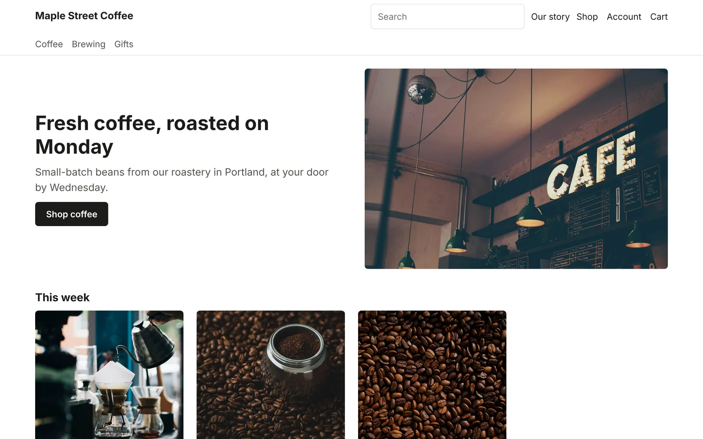
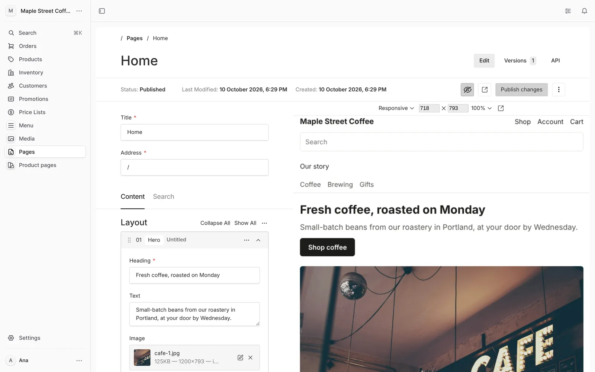
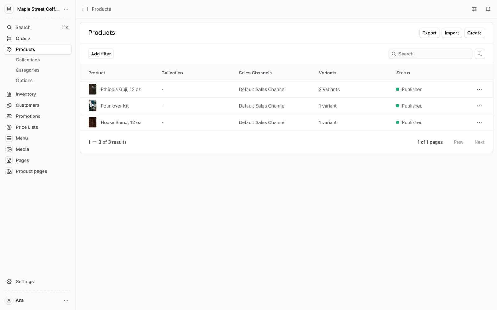
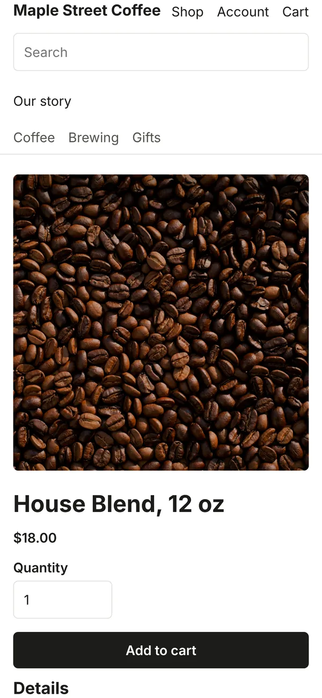

<p align="center">
  <a href="https://whisk.run">
    <picture>
      <source media="(prefers-color-scheme: dark)" srcset="https://github.com/whisk-hosting/cli/raw/main/.github/whisk-wordmark-light-ink.svg">
      
    </picture>
  </a>
</p>

<h1 align="center">Shop</h1>

<p align="center">
  <strong>A business's website and online shop in one, with one admin, live on Whisk from one prompt.</strong>
</p>

<p align="center">
  
  
  
  
  
</p>

<p align="center">
  <a href="#put-it-live">Put it live</a> ·
  <a href="#what-you-get">What you get</a> ·
  <a href="#make-it-yours">Make it yours</a> ·
  <a href="#what-whisk-is">What Whisk is</a> ·
  <a href="#how-it-works">How it works</a>
</p>

<p align="center">
  
</p>

## Put it live

Give your coding agent (Claude Code, Codex, Cursor, Gemini CLI or any other) this prompt:

> Read https://whisk.run/skill and install the Whisk CLI. Then, in a new empty folder, run
> `whisk init --template shop` and `whisk deploy`, and give me the address the shop is live at
> and the address of its admin. If it needs more memory, tell me where to turn on Boost.

Or run it yourself:

```sh
curl -fsSL https://whisk.run/install.sh | sh     # Windows: irm https://whisk.run/install.ps1 | iex
mkdir my-shop && cd my-shop
whisk login
whisk init --template shop
whisk deploy
```

The shop is live at `https://<app>--<business>.whisk.page`, selling in New Zealand dollars with
GST included. Open `/app` on it and sign in with your Whisk account to add products and pages.
It needs about 700 MB of memory: a paid Whisk plan with Boost on the app, or a Promoted app,
which an owner turns on from the app's page in the dashboard. Customers can pay by bank transfer
as soon as the business's account number is in the admin; cards, Apple Pay, Google Pay, Afterpay,
Windcave and PayPal switch on when their keys are set ([Take payments](#take-payments)).

## What you get

<p align="center">
  
</p>

- **One admin for everything** at `/app`: orders, products, stock, customers, promotions and
  price lists beside Pages, Product pages, Menu and Media. The team signs in with their Whisk
  accounts, so there are no passwords to share.
- **A shop**: categories, collections, search, a cart, checkout, customer accounts with an
  emailed sign-in code or a password, order history, and order and password emails.
- **Payments**: cards, Apple Pay, Google Pay and Afterpay through Stripe, cards through
  Windcave, PayPal, and bank transfer, with payment taken when an order is placed or when it is
  sent.
- **New Zealand or Australia**: prices in NZD with 15% GST or AUD with 10% GST, included in
  prices or added at checkout, with delivery set up on the first deploy.
- **A website around it**: pages built from blocks (hero, text, picture, columns, products,
  form, HTML) at any address, and a story under each product's live price, options and stock.
- **A live preview** beside the editor that follows each change, drafts only the team can see,
  and every earlier version kept.
- **Forms** that save each entry in the shop's own database, behind a bot check.
- **Search engines covered**: one `sitemap.xml` and `robots.txt` for the shop and the website,
  page titles and descriptions, and old addresses sent to new ones in one hop.
- **Built for phones first**, with every page drawn on the server.
- **Hosting handled by Whisk**: HTTPS, your own domain, backups, logs, storage for product
  pictures, email, and a move to another server by itself if one fails.
- **Trade ordering** for businesses that sell to other businesses (companies, trade prices,
  approvals, pay on account) comes with a Promoted app.

<p align="center">
  
  &nbsp;
  
</p>

## Make it yours

The live shop is a plain, tidy start. Ask your agent for the rest, in the same folder:

> Restyle this shop for my business, Maple Street Coffee, a roastery in Portland. Use warm colors
> and a serif for headings, add our three coffees and a pour-over kit with their prices, and an "Our
> story" page, then deploy it.

> Take card payments with Stripe and tell me exactly where to paste each key.

> Point shop.example.com at this shop.

Products, prices, stock, words and pictures are changed in the admin by anyone on the team; the
look and new kinds of blocks are changed in the code, by the agent.

## What Whisk is

[Whisk](https://whisk.run) is hosting for business apps and websites built by AI coding agents.
The agent installs the `whisk` CLI, describes the app in `whisk.yaml` and runs `whisk deploy`;
Whisk supplies sign-in, a Postgres database, backups, storage, email, scheduled jobs and
security, so the agent writes only the app. This shop is one of its starting points, with the
[website](https://github.com/whisk-hosting/site) and the starter apps in the
[CLI](https://github.com/whisk-hosting/cli).

## How it works

A business's website and online shop on Whisk, headless, in one app on one address. Astro draws
every page from two back ends beside it: [Medusa](https://medusajs.com) for products, prices,
stock, carts, orders and payments, and [Payload](https://payloadcms.com) for the website's pages,
each product's story, the menus and the pictures. It sells in New Zealand dollars with GST
included, or in Australia (`SHOP_COUNTRY`, below), takes cards, Apple Pay, Google Pay and
Afterpay through Stripe, cards through Windcave, PayPal, and bank transfer, and emails customers
their orders. Customers sign in with an emailed code or a password. Any business can run it.
It needs about 700 MB of memory, which a Promoted app has; trade ordering (companies, trade
prices, approvals, pay on account) comes only with a Promoted app (`promoted: true` and
`b2b: true`).

The business's Whisk team runs everything from one admin at `/app` with their Whisk sign-in:
orders, products and customers, and beside them Pages, Product pages, Menu and Media, which open
Payload's editor inside the admin. A page is a list of blocks (hero, text, picture, columns,
products, form, HTML) at an address; drafts are seen only by the team, in a preview that follows
the edit. A product's page at `/products/<handle>` shows its live price, options and stock from
Medusa, then the blocks of the product page with the same handle. A form block posts to
`/forms/<name>`, kept in the database's `form_entries` table.

The shop's pages are at `/shop` (its home), `/products`, `/categories`, `/collections`, `/cart`,
`/checkout`, `/account`, `/order` and `/search`; every other address is the website's, with one
`sitemap.xml` and `robots.txt` for both. `/` is the website's page at `/`, or the shop's home
until there is one. Old addresses go in `redirects.json` (`{"from": "/old", "to": "/new"}`, or
`"status": 410` for a page that is gone). Starting content goes in `cms/content/` and is added
once, never over an edit (`cms/src/content.ts` says how).

The look is `storefront/` (Astro): the layout, the blocks (`storefront/src/blocks`, one per
Payload block in `cms/src/blocks`) and `src/styles/shop.css`. Change a block in both places, then
`cd cms && npx payload migrate:create <name>` for the database.

```
medusa-config.ts            Medusa on Whisk: database, cache, storage, email, payments
migrate.ts                  the migrate step: Medusa's migrations, src/scripts/setup.ts, Payload's
src/scripts/setup.ts        NZD with GST, the New Zealand region, delivery, the storefront's key
src/api/middlewares.ts      staff-only admin, rate limits, the editor at /cms, the storefront
src/lib/cms.ts              starts Payload beside Medusa and passes /cms to it
src/admin/routes/           Pages, Product pages, Menu and Media in the admin
src/api/auth/               sign-in codes for customers; /auth/whisk signs staff in
src/modules/                Whisk storage and email, and the Windcave and PayPal providers
src/subscribers/, src/jobs/ order and password emails
storefront/                 every page: the website's blocks and the shop's pages
cms/                        Payload: pages, product pages, menus, media, its migrations
scripts/shop.mjs            build, start, migrate, dev
```

## Run it on your computer

`whisk dev` needs Docker with the compose plugin. It starts Postgres, the cache and a local edge,
then runs the shop with the environment it has in production:

```
npm install
npm run build
whisk dev --as you@example.com --roles owner -- npm run start
```

These lines work the same in PowerShell, Command Prompt and a Unix shell. `whisk dev` runs the
migration (`node migrate.js` in the build) first. Open http://127.0.0.1:3000 for the shop and
http://127.0.0.1:3000/app for the admin. `npm run dev` instead rebuilds the server as its source
changes.

## Where it sells

New Zealand, in New Zealand dollars with 15% GST included in prices, unless `env` in
`whisk.yaml` says otherwise before the first deploy (setup adds the market's region, tax and
delivery once and then leaves them to the admin):

| Setting | Values |
|---|---|
| `SHOP_COUNTRY` | `nz` (default) or `au`: Australian dollars, 10% GST |
| `SHOP_PRICES_INCLUDE_TAX` | `false` when prices are entered before tax and the tax is added at checkout |
| `SHOP_TIME_ZONE` | the time zone order dates are shown in, such as `Australia/Perth` |

With prices before tax, the cart, checkout, order pages and emails show lines and the subtotal
before tax, the tax on its own line, then the total.

## Hear of each order

Set `SHOP_ORDERS_TO` in `env` to the addresses, separated by commas, that are told of each new
order: what was bought, who by, how it was paid, and a link to the order in the admin.

## Start with a catalogue

`catalogue/catalogue.json` lists products to start with: `{"products": [{"handle":
"ethiopia-guji", "title": "Ethiopia Guji, 250 g", "price": 24, "sku": "ETH-250", "categories":
["Coffee"], "options": [{"title": "Grind", "values": ["Whole beans", "Ground"]}], "images":
["guji.jpg"]}]}`. Prices are entered as the market enters them (with or without tax);
`inStock: false` lists a product as sold out until staff add stock. A picture is a file in
`catalogue/images`, stored on Whisk, or an address (`/catalogue/guji.jpg` from
`storefront/public`, or `https://…`) used as it is. A job adds every product and category the
shop does not have yet, by handle, within a minute of each deploy, so products staff change in
the admin are never overwritten.

## Take payments

Bank transfer is on once the business's account is in the admin: Settings, Store, Metadata,
`bank_account_name` and `bank_account_number`. Each other way to pay is on when its secrets are
declared under `secrets` in `whisk.yaml` and a person sets their values in the dashboard (the
deploy waits until they have):

| Provider | Secrets |
|---|---|
| Stripe | `STRIPE_API_KEY`, `STRIPE_PUBLISHABLE_KEY`; the shop makes its own webhook. Add `STRIPE_TEST_API_KEY` and `STRIPE_TEST_PUBLISHABLE_KEY` for a test mode switch |
| Windcave | `WINDCAVE_USERNAME`, `WINDCAVE_API_KEY` |
| PayPal | `PAYPAL_CLIENT_ID`, `PAYPAL_CLIENT_SECRET` |

Stripe's webhook needs no setting: on start the shop makes its endpoint at
`https://<shop>/hooks/payment/stripe_stripe`, keeps its signing secret sealed in its own database,
follows the shop to a new address, and replaces any other endpoint at that address. A restricted
key needs Webhook Endpoints: Write as well as what payments need. To manage the endpoint yourself,
set `STRIPE_WEBHOOK_SECRET` (and `STRIPE_TEST_WEBHOOK_SECRET` for the test keys) and the shop
leaves Stripe's endpoints alone.

With test keys set too, the admin's Store page has a Stripe test mode switch. New payments use the
mode it is in, from the next payment on, with no deploy; a payment made in one mode is captured
and refunded in that mode after a switch, and an order paid in test mode is marked on its page.

`*_CAPTURE: manual` in `whisk.yaml` takes payment when an order is sent rather than when it is
placed; `WINDCAVE_ENVIRONMENT` and `PAYPAL_ENVIRONMENT` other than `live` use their test
systems.

## Test it

`npm test` runs the unit tests; `npm run typecheck` checks the types of the server and the pages,
and `cd cms && npm run typecheck` those of the editor.

## Ship it

`whisk doctor`, then `whisk deploy -m "<what changed, for the shop's customers and staff>"`.

## Licence

MIT. The photographs in the screenshots are from [Unsplash](https://unsplash.com), and Maple
Street Coffee is made up.
